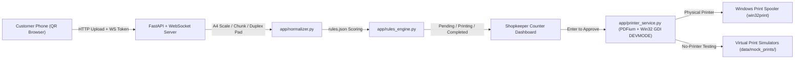

# PrintShop Local Queue (`printqueue-local`)

Zero-cloud local print-shop queue and Windows print automation engine. Walk-in customers scan a counter QR code over local Wi-Fi to submit `.pdf`, `.jpg`, `.png`, or `.docx` files with print preferences and track a live 3-digit token (`#042`) over WebSockets—while the shopkeeper approves, normalizes, chunks, and spools jobs to Windows printers with keyboard shortcuts (`Enter` / `Esc`).

---

## Why This Exists

Small print shops and campus copy centers still rely on WhatsApp Web, email, or USB drives to receive customer files—cluttering personal phones, leaking customer documents, and forcing manual page-setup/printer selection for every job. `printqueue-local` replaces that workflow with a **zero-cloud, zero-install LAN queue** and deterministic print automation.

---

## Architecture & Flow



---

## Key Features (Implemented)

* **Zero-Install Customer Mobile UI (`/`):** Shop-branded entry, local Wi-Fi + auto-delete badge, automatic page count probing (including `.docx`), B&W / Color, 1-Sided / 2-Sided, custom page ranges, price estimate, and live WebSocket queue position.
* **Shopkeeper Counter Dashboard (`/admin`):** 3-tab queue (`Pending`, `Printing`, `Completed`), best-matching printer pre-selected, keyboard triage (`Enter` approve, `Esc`/`Del` reject), normalized PDF preview, Counter QR modal, and First-Run Onboarding.
* **Deterministic Document Normalizer (`app/normalizer.py`):**
  * Auto-rotates and fits `.jpg` / `.png` images to A4 PDFs.
  * Converts `.docx` via LibreOffice (if installed) or built-in `python-docx` + ReportLab fallback.
  * Scales non-A4/oversized PDFs to A4 without mutating detached reader pages (`pypdf 7.x` safe).
  * Pads odd-page duplex jobs with a trailing blank page and splits jobs `> 50` pages into even-sized chunks.
* **Windows GDI Spooler + Virtual Fault Simulator (`app/printer_service.py`):**
  * Renders PDF pages via `pypdfium2` directly to Windows GDI (`win32gui.CreateDC` + `win32ui`) with `DEVMODE` (`DMPAPER_A4`, `DMCOLOR_*`, `DMDUP_*`, `dmCopies`) and `win32print.EnumJobs` health checks.
  * Includes `Virtual Print Simulator (PDF)`, `Virtual Backup Laser (B&W)`, and `Virtual Faulty Printer (Jam Test)` to test mid-job Paper Jams and 1-click **Reroute Remaining** (resuming only unprinted chunks) without physical hardware.
* **Hot-Reloadable `rules.json` & Privacy Cleanup:** Automatically reloads `data/rules.json` on file change without restarting, expires unapproved pending jobs after 15 minutes, and wipes completed temp files after a 3-minute grace window.

---

## Engineering Trade-Offs

* **Zero-Cloud Local-First Architecture:** Avoids recurring cloud relay/storage fees and keeps sensitive customer documents on the shop's LAN.
* **Deterministic `rules.json` over Heavy AI:** Printer scoring, chunk thresholds, and driver quirks are predictable, auditable, and hot-swappable in a small JSON playbook.
* **Bundled `pypdfium2` + Windows GDI over External Binaries:** Eliminates external `SumatraPDF.exe` dependencies while allowing direct `DEVMODE` control and fail-loudly spooler error handling.
* **Standard-User Runtime:** Daily operation requires zero Administrator UAC prompts; firewall/startup setup belongs strictly to a one-time installer step.

---

## Quickstart (Windows)

```powershell
# 1. Create and activate local virtual environment
python -m venv .venv
.\.venv\Scripts\activate

# 2. Install dependencies
pip install -r requirements.txt

# 3. Launch server and open Shopkeeper Dashboard
python run.py
```

* **Shopkeeper Dashboard:** `http://127.0.0.1:5050/admin`
* **Customer Mobile UI:** `http://<your-lan-ip>:5050/` (or scan the **Counter QR Code** in the dashboard)

> **Testing without a physical printer:** Keep `Virtual Print Simulator (PDF)` selected in **Shop Settings**. Approved jobs save normalized A4 chunks and `receipt.json` into `data/mock_prints/`.

---

## Running Tests

```powershell
.\.venv\Scripts\python.exe -m pytest -v
```

---

## License

MIT — see [LICENSE](LICENSE).
